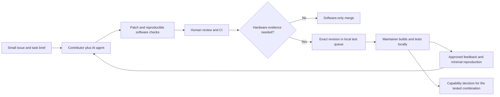

# Contribute with your AI agent, without owning the hardware

For the shortest setup, use the [contributor quickstart](CONTRIBUTOR_QUICKSTART.md). It configures a private inbox and prints the Claude Code or Codex connection command.


You can contribute using your own AI coding subscription and development environment. You do not need a drone, an Apple device, a DJI account or shared maintainer credentials for the software-only tasks. AI assistance is welcome; the contributor remains responsible for understanding the patch, checking its sources and reporting what actually ran.

Choose one useful deliverable. A reviewed fix, a small original fixture or a clear negative finding is valuable. A large amount of generated code does not by itself advance a stage.

## Choose work that matches your environment

| Available environment | Good starting work | What it cannot establish |
|---|---|---|
| Agent with repository access and a Swift-capable Linux or cloud shell | Core contracts, synthetic replay, boundary tests, handoff tooling and documentation | iOS compilation, accessory access or DJI behavior |
| Agent that proposes edits but cannot execute commands | Research, documentation and patches that you test yourself or submit with clearly unrun checks | A passing test result without an actual run |
| Mac with Xcode, without a drone | iOS compiler checks, original adapter boundaries and synthetic stream-lifecycle tests | Physical iPhone/controller communication |
| Maintainer's local hardware setup | Reviewed signed builds and narrowly scoped device experiments | Untested combinations or later capabilities |

See [the backlog](CONTRIBUTOR_BACKLOG.md). LAB-004 and LAB-005 are starting points for software-only work; LAB-002 is a research task. Native hardware implementation remains subject to its [roadmap gates](ROADMAP.md).

## The working loop

For ongoing assignments and feedback, use the [GitHub event workflow](AGENT_EVENT_WORKFLOW.md) and [opt-in template](templates/AGENT_SUBSCRIPTION.md). The [implemented inbox pilot](AGENT_INBOX_DEPLOYMENT.md) delivers notifications to one opted-in contributor; [Claude Code instructions](CLAUDE_CODE_PILOT.md) show how to consume it. A GitHub connection supplies repository access; event delivery and permission to run a coding task are separate. Consult the deployment record for live status.



1. **Pick and coordinate.** Comment on an existing issue with your proposed scope and environment. Check for another active contributor before starting overlapping implementation. The maintainer can narrow the task or record an owner. Start with one active task and one small PR.
2. **Fork and reproduce the baseline.** Work on a topic branch in your fork. Read `AGENTS.md`, `README.md`, `CONTRIBUTING.md` and the relevant stage. Run the available checks before editing. If your agent cannot run them, say so and use CI or your own terminal; do not let it invent results.
3. **Give the agent a bounded task.** Use [the agent task template](templates/AGENT_TASK.md). Apply the [reuse-first policy](PORTING_POLICY.md): establish why a component is needed, preserve compatible code and document any actual iOS incompatibility before porting it. Specify the relevant files, expected behavior, tests, forbidden scope and stopping point. Read the proposed changes yourself. Ask for a concise handoff describing decisions, files, commands, results and remaining uncertainty.
4. **Open a draft PR early enough to avoid duplicate work.** State the task ID and question, then update the description as the implementation settles. Separate tests run locally, CI results and checks not run. Explain AI assistance briefly; full chat histories, hidden reasoning, subscription details and private prompts are unnecessary.
5. **Respond to review.** The human contributor must be able to explain the behavior and sources. Correct tests that merely restate an implementation assumption. An unsupported API invented by an agent is a defect to resolve, not a hardware experiment to send to the owner.
6. **Request a hardware slot only when needed.** After software review, commit the experiment description and freeze the requested revision. Prepare the metadata handoff below. Record both the PR head SHA and the commit tested by CI when they differ; a PR workflow may test a merge result. The maintainer reviews the source and build path, builds/signs locally and records the actual artifact identity before using a device. A PR, green CI or complete handoff is not device approval.
7. **Turn feedback into a small follow-up.** Use the maintainer's publication-approved feedback. Where possible, create an original synthetic fixture that reproduces the failure class. Keep it marked synthetic; it is not a raw hardware trace. A fix gets a new commit and, if hardware behavior changed, a new run.

## Software checks and the handoff

Run the applicable repository checks from its root:

```sh
swift test
swift run msdk-ios-replay
python3 tools/check_repository.py
python3 -m unittest discover -s tools/tests -v
```

With Make installed, `make check` runs this software check set. Python tests live under `tools/tests/`, separate from Swift's case-sensitive `Tests/` directory.

Record the actual command, environment, exit result and relevant output in the PR. Hardware checks remain `NOT RUN` unless the local maintainer has performed them. Host and CI execution are independent evidence, and neither proves device support.

For a reviewed experiment, commit its descriptor and use a clean tracked working tree:

```sh
python3 tools/prepare_handoff.py \
  --experiment experiments/example-synthetic.json \
  --output artifacts/handoff
```

The example describes software-only synthetic replay. Replace it with a task-specific descriptor for a real handoff, following [the handoff format](HANDOFF_FORMAT.md). The tool produces `manifest.json`, `experiment.json` and `SHA256SUMS`, pinning the source commit and experiment identity. Untracked files are excluded; they cannot be part of the requested build or claimed test evidence. The tool does not run tests, package an executable, scan for secrets, contact hardware or verify approval. A complete metadata record still needs review. Read-only hardware descriptors with missing target details or unresolved prerequisites remain draft.

Share the PR URL, full source commit and these small metadata files with the maintainer. Source remains in the fork/PR; signing material, private logs and binaries are not part of this bundle. Changes after the handoff require a new commit and regenerated bundle; a changed PR head invalidates the queued experiment until reviewed again. A test result for an older revision never silently transfers to the new one.

## Two definitions of done

**Software-only task:** the agreed behavior is implemented, relevant checks pass, sources and limitations are documented, and a maintainer reviews the PR. It can merge without waiting for a drone. Its completion advances only the software task.

**Hardware-dependent task:** software review makes it eligible for a local test, but the capability stays open until the exact revision/artifact and device combination have an accepted run. An explicitly experimental, disabled adapter may be merged after review while its hardware issue remains open; the README and compatibility ledger must still say unvalidated. A failed or blocked experiment is a legitimate result with a next question, not a reason to label the feature complete.

## Use AI without sharing private material

Your subscription stays yours; there is no credential sharing, required provider or requirement to buy additional API credits. Tool access and execution environments vary, so report what your setup can actually do. Set your own spending/time limits and stop when a task depends on unavailable hardware or permission. Return the smallest unanswered question rather than generating speculative implementation indefinitely.

Give agents public repository material and original synthetic fixtures by default. Do not upload raw device logs, private captures, signing files, accounts, location data or SDK-restricted material to an external AI service as part of ordinary collaboration. Even a redacted hardware report needs an appropriate publication/use decision before sharing; a maintainer's private test access is not permission to forward it. [Hardware testing](HARDWARE_TESTING.md) and [third-party boundaries](../THIRD_PARTY_NOTICES.md) define those limits.

Contributors receive credit for code, tests, research, reviews and documentation. AI usage is context for review, not a measure of contribution quality.
